# gopod: implicit finite state machines audit

Date: 2026-11-08. Repository `~/_code/coriolis/gopod` at `da529a8` (main, clean apart from untracked `.agents/`, `.codex/`).
Method: five parallel read-only code audits by area (turns/queue, tasks, delivery, runner/sessions, telegram/host), then spot verification of the highest-impact claims by reading the cited lines. Items marked **verified** were re-read by the author; the rest are reported from the area audits, which cited file:line for every transition.

"Implicit" here means: the state is a status column, a flag set, or a free-text sub-state, and the transitions are spread over several writers with no single transition function. Several machines below have a `CHECK` constraint on the column (explicit state *set*) but still implicit *transitions*.

---

## 1. Durable turn (`turns.status` + `attempts`, `reply_msg_id`, `error` text)

Entity: one Telegram message or task occurrence being run by the agent. Spec declared `pending -> running -> done|failed|interrupted` (`docs/superpowers/specs/2026-10-03-durable-turns-design.md:46-53`); code has 6 statuses (`internal/store/turns.go:13-22`) and 12 writers.

States (effective state is a tuple):
- `status`: pending, running, done, failed, interrupted, stopped
- `attempts` 0 vs >0; `reply_msg_id` 0 vs set; `error` containing `execution_unknown` (sub-state matched by `strings.Contains`, `internal/telegram/control_recovery.go:79,201`)
- Side tables gate transitions: `turn_result_members` (frozen), `delivery_groups` (published), `ordinary_stop_members` (stop intent), `task_attempts` (managed)

Transitions (from | to | event | guard | location):
- none | pending | `InsertTurn` | UNIQUE(source,source_id) | `internal/store/turns.go:92-104`
- pending/running/interrupted(att=0) | running | `StartTurnBatch` | atomic batch fence: snapshot attempts, no frozen member, no stop member, reply=0 | `internal/store/turn_batch.go:55-69`
- any | running | `MarkTurnRunning` (managed path) | **none**, `WHERE id=?` | `internal/store/turns.go:130-134` (caller `internal/queue/managed.go:600`)
- running | done | handler nil, no shutdown | in-memory only | `internal/queue/queue.go:539-542` -> `MarkTurnFinished` `turns.go:140-144` (**no status guard**)
- running | stopped | `ErrStopped` | — | `queue.go:544-547`
- running | failed | NoReplay / Draining / retries>5 / forced | — | `queue.go:511-523, 550-564, 571-585`
- running | interrupted | worker ctx cancelled | — | `queue.go:524-537, 586-594`
- pending | stopped | runCtx cancelled after `beginBatch` | `runCtx.Err()!=nil` | `queue.go:457-461, 485-489` (**verified**)
- pending | stopped/failed | conversation cancellation | queue mutex | `internal/queue/conversation.go:68-75`
- pending | stopped | `ForceDrain` pending task items | — | `internal/queue/drain.go:147-151`
- pending(task, att=0) | stopped | `cancelUnstartedAttemptQ` | CAS `status='pending' AND attempts=0` | `internal/store/task_runs.go:499-510`
- pending/running/interrupted | stopped(att=0) / failed(att>0) | `RecordForcedTurns` | CAS on status set | `internal/store/restart.go:196-243`
- **any** | stopped | `SettleForcedTurns` | **none on status** | `internal/store/restart.go:265` (**verified**)
- **any** (managed) | stopped | cmd `settleForced` -> `MarkTurnFinished` | **none** | `cmd/gopod/restart.go:594` (**verified**)
- unfinished, att>0, no reply, no frozen | failed `execution_unknown` | boot `RecoverOrdinaryTurn` | one tx | `internal/store/ordinary_recovery.go:98-100,108` (**verified**)
- unfinished, reply!=0 | done | boot | — | `ordinary_recovery.go:101-103`
- unfinished + frozen + delivery | done | boot | scope match | `ordinary_recovery.go:81-97`
- unfinished + frozen, no delivery | (hold) | boot -> `RecoveryHold` item | — | `cmd/gopod/main.go:1239-1243`
- unfinished + stop member | failed | boot | — | `ordinary_recovery.go:63-70`
- pending/running (managed) | done/stopped/interrupted/failed | ledger-driven closes | ledger state | `internal/queue/managed.go:355-393, 405-420, 636-677`
- field `reply_msg_id` | set | `SetTurnReply` | **none** (comment says first-write-wins) | `turns.go:156-159`; CAS variant only in outbox path `internal/store/results.go:313`

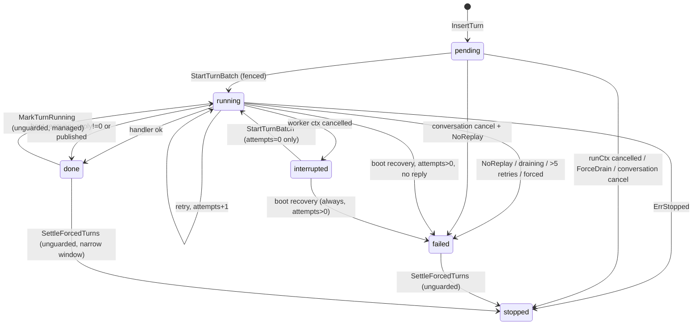

Tests: primitives, batch fence, done/failed/stopped/interrupted, boot recovery matrix, conversation cancel, managed closes covered (`internal/store/turns_test.go`, `turn_batch_test.go`, `ordinary_recovery_test.go`, `internal/queue/queue_test.go`, `managed_test.go`, `cmd/gopod/managed_turns_test.go`). **Not covered**: `SettleForcedTurns` and cmd `settleForced` (no test references), pending->stopped at `queue.go:457/486`, drain-became-true-during-backoff (`queue.go:573-576`), `SetTurnReply` overwrite, conversation NoReplay->failed.

Problems:
1. `MarkTurnFinished`, `MarkTurnRunning`, `SetTurnReply` have no state guard; forced-restart settlers overwrite `failed`/`done` with `stopped`.
2. Shutdown race: freshly drained pending input finished `stopped` with reason "forced restart" though no force happened (`queue.go:457-461`). Terminal, message lost.
3. Production boot recovery (`main.go:1233-1247` + `ordinary_recovery.go:98-106`) settles every ordinary row with `attempts>0`; so `Resumed`, `ErrCrashLoop`, `resumePrompt`, `pickBatchItem` and the spec's "re-enqueue interrupted" arrow are dead in production. Only fake-store tests exercise them.
4. `execution_unknown` is a sub-state in free text, matched by substring in UI code.
5. `finish()` writes one row per coalesced item without a transaction (`queue.go:691-698`): siblings can end in different statuses.
6. Queue lane (`chatState.active/held/ordinaryHold/retries/resumeAfterDrain` + `Queue.draining/forcing/closed`): `ordinaryHold` and `forcing` have no in-process exit (`internal/queue/ordinary_hold.go:5-8`, `drain.go:90-92`); `CancelDrain` after a failed force is a silent no-op. `held` counter mixes two hold kinds. `drainPending` is dead code.
7. OnDone semantics differ by writer (user Stop passes nil error, so `scheduler.onTurnDone` logs a legacy task stop as success, `internal/scheduler/scheduler.go:71-74`).

---

## 2. Managed task ledger (`task_runs.execution_state` x `task_attempts.execution_state` x `reservation_state` x `publication_state` x `effects_state`)

Entity: one admitted occurrence of an agent task (CP-004). Typed edge table exists (`internal/store/task_runs.go:42-50`) with DB triggers for terminal finality, so the *set* is explicit; the aggregate over five columns and the operator exits are implicit.

Wiring: no production admission path. `AdmitTaskOccurrence`, `CreateManagedTask`, `DueManagedTasks`, `RequestRunStop`, `ReconcileRunEffects`, `TransitionRun` are test-only callers (**verified** by grep). Production touches the ledger only through `cmd/gopod/managed_turns.go` adapters, `cmd/gopod/restart.go` and `internal/store/task_report.go`, gated by `GOPOD_MANAGED_TASKS`.

Key transitions:
- queued/none | reserved/held | `ReserveTaskAttempt` | CAS queued; no frozen result; recheck | `internal/store/task_dispatch.go:136`
- reserved/held | running/held | `BeginTaskSpawn` | CAS reserved | `task_dispatch.go:189-192`
- running | completed/failed/interrupted (released) | `SettleTaskAttempt` with evidence | CAS; evidence releases `held`->`released` | `task_dispatch.go:315-327`, `task_runs.go:344-347`
- running | cancel_requested -> cancelled | `SettleStopped` two steps | — | `task_dispatch.go:319-327`
- any live | execution_unknown (effects `unresolved`) | `SettleUnknown` / `RecoverTaskAttempt` | reservation untouched | `task_dispatch.go:302-310, 396`; `task_runs.go:279-281`
- execution_unknown/held | cancelled/released | forced restart `settleForced` | — | `cmd/gopod/restart.go:584-585`
- held | released | `ReleaseAttemptReservation` | `WHERE reservation_state='held' AND state IN (unknown, terminals)` | `task_runs.go:379-382`
- queued/running | cancel_requested | `requestRunStopQ` | **`WHERE run_id=?` only** | `task_runs.go:486`
- `publication_state`, `task_runs.result_id`: **no writer anywhere**; `effects_state` unresolved -> reconciled only via `ReconcileRunEffects` (no production caller)

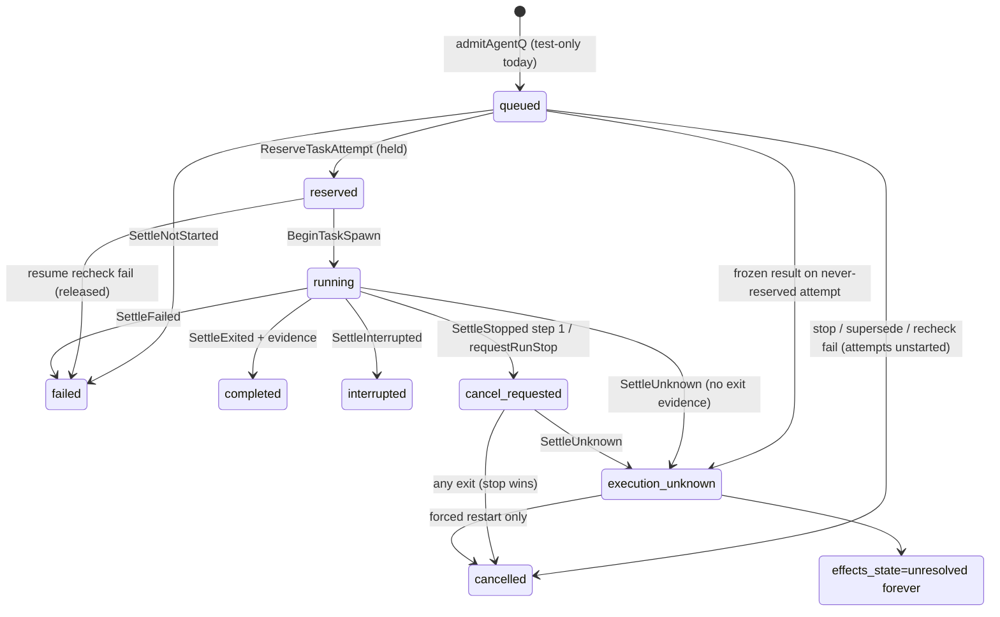

Tests: edge graph, CAS races, stop semantics, settle matrix, recovery, real-store integration covered (`internal/store/task_runs_test.go`, `task_dispatch_test.go`, `cmd/gopod/managed_turns_test.go`). **Not covered**: `settleForced` managed branch; `execution_unknown` with `reservation_state='none'` follow-up; direct `TransitionAttempt(queued->cancelled)` without evidence.

Problems:
1. **Bug (verified)**: `cmd/gopod/restart.go:580-593` reads attempt `a`, calls `SettleTaskAttempt(SettleStopped, Evidence)` which already flips `held`->`released` (`task_runs.go:346-347`), then tests the stale `a.Reservation=="held"` and calls `queue.ReleaseHold` -> `ReleaseAttemptReservation` -> 0 rows -> `ErrReservationNotReleasable`. `settleForced` returns before `MarkTurnFinished`/`SettleForcedTurns`. Every forced restart with a held managed attempt fails at this step. Untested.
2. Dead end: `execution_unknown` with `reservation_state='none'` (frozen result on never-reserved attempt): invisible to `HeldTaskReservations` (`task_dispatch.go:434-436`), turn closed `failed`, no operator command. Run stays live forever and blocks overlap admission.
3. Only exit from `execution_unknown`/held is forced restart; ordinary restart refuses while held (`restart.go:307-310, 377-380`). No control command calls `ReleaseAttemptReservation`, `ReconcileRunEffects`, `TransitionRun`.
4. `publication_state` and `result_id` never written; `OnFrozen` never set (`main.go:789-801`), so frozen managed results are never published.
5. Exported `TransitionRun`/`TransitionAttempt` move one row; a direct call desynchronises run and attempt and makes `settleQ` lockstep check fail forever (`task_dispatch.go:263`).
6. `RotateGroupEpoch` writes `status='paused'` to managed rows without revision bump (`internal/store/namespace_epochs.go:100`), bypassing the revisioned API.
7. In-memory `Execution{started,confirmed,ambiguous,refused}` flags (`internal/queue/managed.go:177-188`) allow refused -> started on retry within one handler; `addHold` with a full semaphore registers a hold without a slot (`managed.go:447-452`).

---

## 3. Legacy scheduled task (`scheduled_tasks.status` free text + `next_run` sentinel)

Entity: legacy task (`execution_version=0`). `status` is free TEXT without CHECK (`internal/store/schema.go:102`); `next_run` doubles as sub-state: 0 (user pause / done), -1 (`pauseMarker`, proactive global pause, `internal/proactive/pause.go:14`), >0 (scheduled, or paused-by-epoch-rotation). Single store mutator `UpdateTaskStatus` accepts any status, no CAS (`internal/store/tasks.go:143-157`). Serialisation only by in-process `LockTasks` mutex.

Writers (15+): scheduler `runTask` (`internal/scheduler/scheduler.go:147-152, 158-164, 219-220`), `SuppressForcedRestart` (`scheduler/restart.go:46-48`), IPC sink cancel/pause/resume/update (`scheduler/ipc_sink.go:87-90`, `ipc_manage.go:53-100`), `/tasks` pause/resume/cancel (`internal/control/tasks.go:357-391`), proactive PauseAll/ResumeAll/enable (`internal/proactive/pause.go:43,84,101,107,116,137`, `enable.go:145,167,221`), `RotateGroupEpoch` (`namespace_epochs.go:100`, no task lock).

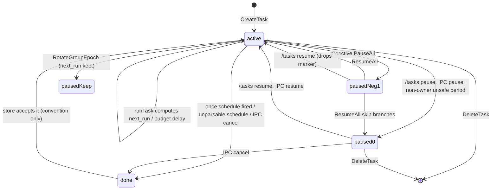

Tests: scheduler happy/dup/enqueue-failure/stale snapshot, IPC cancel, control panel, budget covered. **Not asserted**: scheduler non-owner pause and budget-delay writes (`scheduler.go:149,161`), `IPCSink.Manage` pause/resume/update directly, `FinishTaskRun` overwrite.

Problems:
1. `done` is terminal only by caller convention; store accepts `done -> active`; typos persist.
2. Three paused sub-states distinguished only by `next_run`; `/tasks resume` on a -1 row silently drops the proactive marker, so `ResumeAll` later reports it skipped.
3. No store CAS; correctness depends on every writer holding `LockTasks`; `RotateGroupEpoch` does not.
4. `task_run_logs.status` (running/success/error, no CHECK): `FinishTaskRun` has no predicate; a pre-existing `running` row from a crash stays `running` forever (`scheduler.go:176` skips step 1).
5. `computeNextRun` with an unparsable schedule returns `done` after one fire (`scheduler.go:256-268`).

---

## 4. Outbox part and delivery group (`outbox_parts.state`, `delivery_groups.state` x `unresolved`)

Entity: one message part of a delivery group. State set is explicit (CHECK, `internal/store/schema_delivery.go:86`); transitions are spread over ~12 writers, all but a few guarded by `complete()` (fence + `state=sending` + exactly one open attempt, `internal/store/outbox_dispatch.go:331-356`).

Transitions:
- none | pending | `insertOutboxPartQ` | scope validated in tx | `internal/store/outbox_code_plan.go:106`
- pending | sending | `claimOnce` | CAS pending; `nextCandidateQ` eligibility; attempt row + fence in same tx | `outbox_dispatch.go:173-176, 201-222`
- sending | sent | `AckPart` | complete(); remote id>0 | `outbox_dispatch.go:381`
- sending | pending | `ReleaseUnsent` (429 / proven not sent) | attempts<5, next<expires | `outbox_dispatch.go:367, 440-449`
- sending | failed `retry_budget_exhausted` / expired `retry_beyond_expiry` | `ReleaseUnsent` | — | `:443-445`; tail cancelled `:457-459`
- sending | failed (refusal) | `FailPart` | complete() | `:476-482` (tail -> cancelled `prior_part_failed`)
- sending | uncertain | `MarkUncertain`, `SweepSending` (restart), `SweepOrphanedSending` (grace, not in `live`) | fence | `:496, 564-567`
- sending | sending (new attempt) | plain/keyboard/document fallback | attempts<5, branch not taken | `outbox_plain_fallback.go:29-43` etc.
- pending | expired | `expireDueQ` every claim | `expires_at<=now` | `:281-291`
- pending | cancelled | stale scope / topic retired / `CancelDelivery` / code plan termination | CAS pending | `:159-168, 256-269`; `internal/store/outbox.go:490`
- pending | failed `artifact_quarantined` | `QuarantineArtifact` | CAS pending; **no tail cancel** | `internal/store/artifacts.go:519-529` (**verified**)
- uncertain | sent / cancelled | `SettleUncertain` (owner `/outbox settle`) | CAS uncertain | `outbox_dispatch.go:763`
- group state recomputed by `recomputeGroupState` after each part write (`outbox.go:509-547`); produced pairs: pending/1, partial/1, sending/1, uncertain/1, sent/0, partial/0, failed/0, expired/0, cancelled/0 (7 of 16 schema-allowed pairs never written)

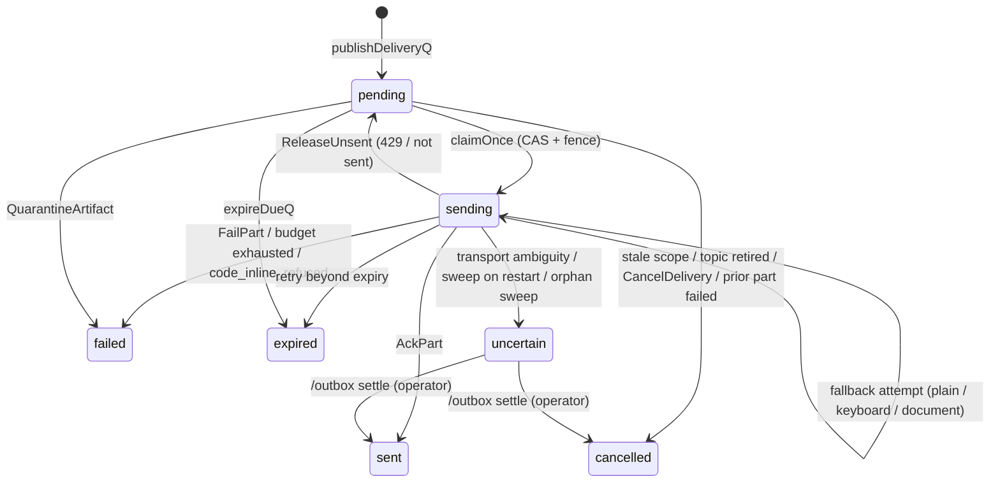

Tests: all dispatcher-side transitions covered (`internal/store/outbox_dispatch_test.go`, `outbox_settle_test.go`, fallback tests, `internal/telegram/outbox_dispatcher_test.go`, `security_wave_test.go`). **Not covered**: `task_deleted` cancel path (`internal/store/task_definitions.go:666`), `CompactTerminalDeliveries` from production (no caller), sending/1 aggregate via real claim.

Problems:
1. `uncertain` has no automatic exit; each uncertain group counts against the admission quota (`unresolved=1`) forever; 1000 of them silently block a namespace (`outbox_config.go:11`, `outbox_retention.go:14`). Operator-only exit.
2. `CompactTerminalDeliveries` has **no production caller** (**verified**): terminal deliveries are never compacted.
3. `QuarantineArtifact` fails one part without cancelling the tail, violating the ordering rule `FailPart` enforces; later parts still send.
4. Fail-closed integrity checks inside the shared claim transaction (`outbox_dispatch.go:155-157, 241, 249`) stall the whole dispatcher (worker logs and sleeps 1 s forever), not one conversation.
5. A part proven unsent whose `ReleaseUnsent` write fails is swept to `uncertain`, degrading a known outcome to operator work (`internal/telegram/outbox_dispatcher.go:439-446`).
6. `RefuseCodeDocument` error path returns without persistence (`outbox_dispatcher.go:316-319`).
7. `partial/0` is a terminal state indistinguishable from `partial/1` except by `unresolved`.

---

## 5. Final reply intent (`final_reply_intents.state`)

States: preparing, ready, published; DB trigger allows only preparing->ready->published (`internal/store/schema_final_reply.go:30-32`). Writers: `BeginFinalReply` (`internal/store/final_reply.go:80`), `StageFinalReply` (`:168`), `PublishReadyFinalReply` (`:288`), boot `recoverReadyFinalReplies` (`cmd/gopod/final_reply.go:15-29`). Host entry `PrepareFrozenFinalReply` has **no production caller** (**verified**).

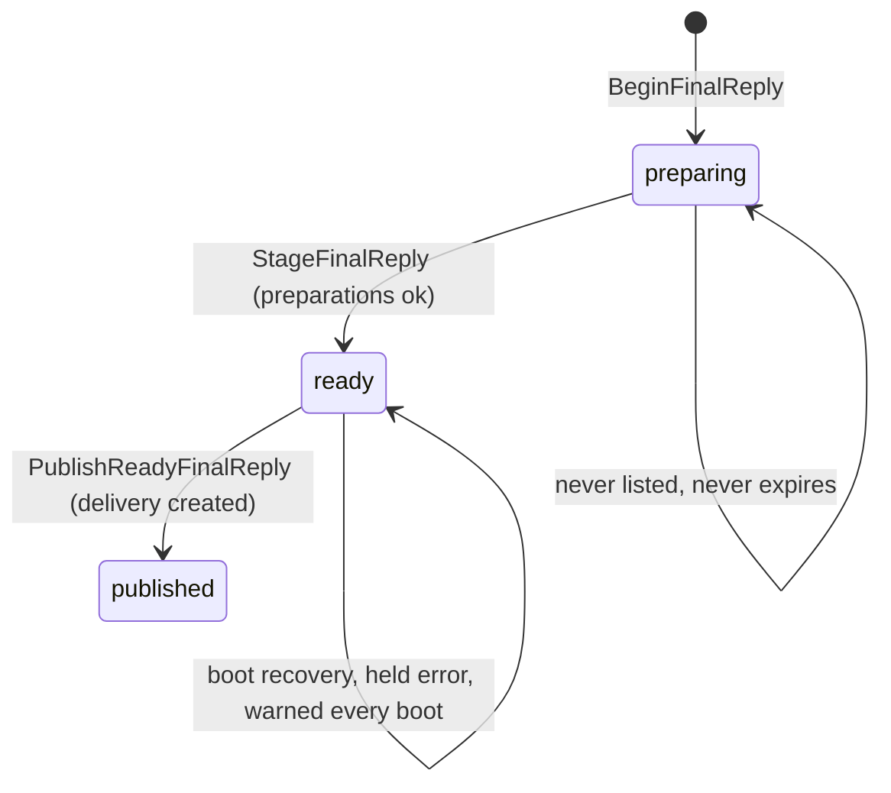

Problems: `preparing` never recovered or expired; `ready` with expired plan or `ErrFinalReplyPublishedElsewhere` re-warned every boot forever, no terminal transition; `published` never reconciled with a later failed/expired delivery. Tests: `internal/store/final_reply_test.go` covers conflict, idempotent stage, concurrency, immutability.

---

## 6. Control message and Telegram attempt ledgers

Entity: a bot-owned control message (`telegram_control_messages`: `terminal` x `acknowledged<revision` x `retry_at`) plus three attempt ledgers (`control_repair_attempts`, `telegram_edit_attempts`, `telegram_delete_attempts`, each `pending|ack|refused`, immutable once settled).

Control message transitions: bind (`internal/store/control_messages.go:48`), checkpoint rev+1 (`:53`), `FinishControlRepair` CAS revision (`:80`), `AcknowledgeControlEdit` **no token/revision CAS** (`:95`, **verified**), `RequeueControlRepair` resets `acknowledged=0` without bumping revision (`:102`), `controlFinalOwnershipQ` (`internal/store/control_final.go:36`), settle via ledgers (`control_repair_attempts.go:139`, `telegram_edit_attempts.go:250`, `telegram_delete_attempts.go:127`).

Ledger transitions: none -> pending (`BeginControlRepair` `:96`, `BeginTelegramEdit` `:207`, `BeginTelegramDelete` `:84`, commit before HTTP) -> ack/refused (`Settle*`, exact identity CAS). Failed settle writes retained only in process memory (receipt maps capped at 128) and retried by `reconcile*Receipts`.

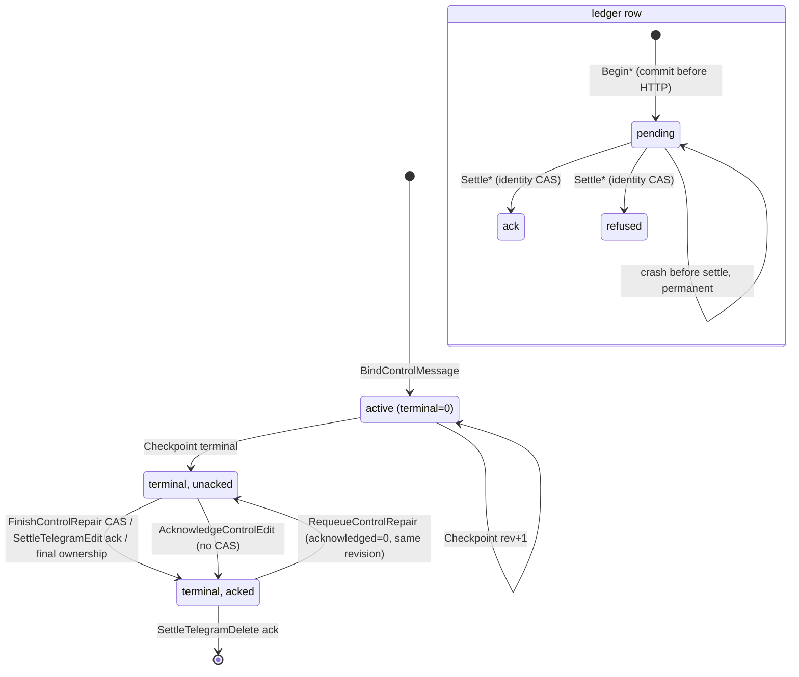

Problems: pending ledger row after a crash is a permanent dead end with no operator command (only `/outbox settle` exists); that message can never be edited again and outbox edits targeting it expire. Stored `terminal` is not authoritative (recomputed per repair from turn status plus in-memory `executionUncertain`, `internal/telegram/control_recovery.go:201-206`). `RequeueControlRepair` vs concurrent `FinishControlRepair` on the same revision can re-acknowledge immediately. Tests: store and telegram ledgers well covered; `chatID<=0` ack gate in `internal/telegram/streaming.go:134,203` not covered.

---

## 7. Topic deletion (`topic_deletions.state`)

States: deleting, uncertain, deleted, retired, refused (`internal/store/schema_topic_deletion.go:17`). Writers `BeginTopicDeletion`, `RecordTopicDeletionOutcome`, `RetireDeletedTopic` (`internal/store/topic_deletion.go:80,135,164`) have **no production callers** (**verified**); readers gate outbox claims, admission and quiescence.

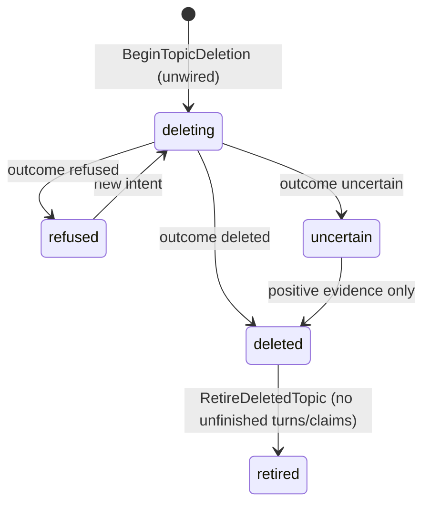

Problems: any existing `deleting`/`uncertain` row is permanent; `uncertain` holds the topic's outbox and code plans and makes `QuiesceTopic` return `ErrTopicRestartReconciliation` forever; `retired` blocks `UnknownMainControlBlocked` permanently (`internal/store/telegram_message_ownership.go:143`). Store tests cover every transition.

---

## 8. Generated preparation (`generated_preparations.state` x `upload_state`)

States: generating, ready, failed, preparation_unknown x none, claimed, sent, refused, unknown (`internal/store/generation.go:93,96`). Produced pairs: generating/none, ready/{none,claimed,sent,refused,unknown}, failed/none, preparation_unknown/none. `ready/none` is overloaded: "never uploaded" and "uploaded via outbox".

Transitions: Begin (`:155`), Complete/Fail/MarkUnknown CAS generating (`:202`, callers `internal/telegram/speech.go:261-311`), sweep of stale generating -> preparation_unknown and stale claimed -> unknown (`:286-291`, `cmd/gopod/outbox.go:121-146`), claim/release/finish upload (`:220, 244, 261`), purge (`:313`).

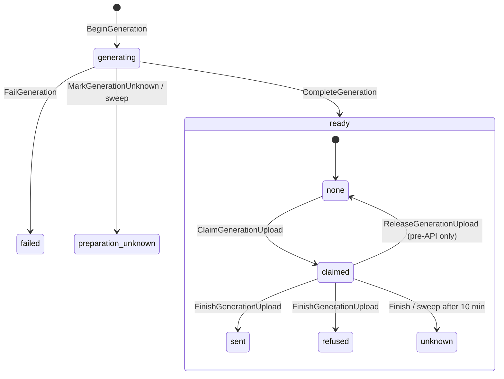

Problems: paid synthesis whose `CompleteGeneration` write fails is swept to unknown and discarded (acknowledged at `speech.go:312-313`); 10-minute sweep on `updated_at` can flip a slow live upload with no in-process `live` set. Tests good (`internal/store/generation_test.go`, `internal/telegram/prepared_test.go`, `speech_test.go`).

---

## 9. Runner per-folder slot, unknown executions, drain flags, quarantine (in-memory)

Entity: `Runner.agentSlots/backgroundCancels/interactiveWaiters/unknownExecutions/operationCancels/pendingGateReleases/draining/forcing` (`internal/runner/runner.go:113-124`) plus `Docker.quarantine` map (`internal/runner/lifecycle.go:50-56`).

States per folder: Free, HeldInteractive, HeldBackground, HeldIdle (indistinguishable from HeldInteractive in the map), Unknown(containerID), Unknown("unresolved"), UnknownGlobal("container:<id>"), Quarantined. Globals `draining`, `forcing`.

Transitions:
- Free | Held* | `acquireSlot` | no quarantine, no unknown, admission ok, `verifyQuiescent` | `internal/runner/agentkill.go:151-209`
- Held | Free | `slotReleaser` once (touch refresh) | — | `internal/runner/drain.go:170-178`
- any | Unknown(id) | `markExecutionUnknown` | **none** | `drain.go:139-147`; callers `agentkill.go:117`, `runner.go:742-744`, `fresh.go:35-37`, `task_run.go:301-303`, `drain.go:322-324`
- none | Unknown(unresolved) | `releaseGateWhenSettled` inspect error | — | `drain.go:367-377`
- Unknown(id) | cleared | `reconcileExited` | **`containerDead(id)` only** | `drain.go:236-244` (**verified**)
- Unknown(unresolved) | cleared | `reconcileExited` | container absent/dead/quiescent | `drain.go:224-235`
- open | draining | `BeginDrain` (`:25`); any | forcing | `CancelActive` (`:99-108`); draining/forcing | open | `CancelDrain` (`:33`)
- none | Quarantined | `inventoryLeftovers` for non-exited leftovers | — | `lifecycle.go:50-56`
- Quarantined | cleared | `quarantined()` observes death (`drain.go:268-275`) or `stopQuarantined` on force (`:350-357`)

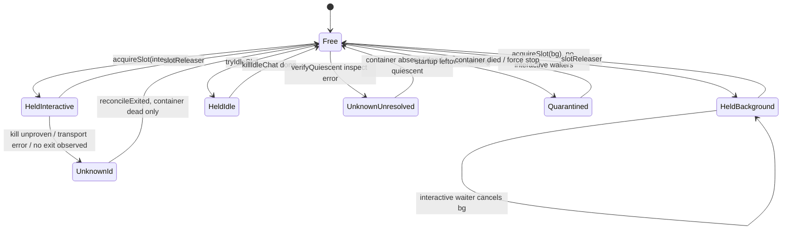

Tests: `internal/runner/drain_test.go:10-129` cover slot, drain, idle, unknown blocking, operation cancels, gate parking. **Not covered**: `reconcileExited` clearing (unit tests have `r.d==nil`, early return at `drain.go:214`), `Unknown(unresolved)`, `verifyQuiescent`, `stopQuarantined`, `inventoryLeftovers` (integration tag only).

Problems:
1. Dead end: `Unknown(id)` clears only on container death. If the exec exited but the PID1 container lives, the folder is blocked forever: idle watcher refuses, `ForceDrain` stops only the quarantine map, `WaitDrained` returns `ErrExecutionUnproven`.
2. `startStream` reads `handle.Done` once (`runner.go:738`); a demux error followed by the daemon `ExecError` lands in the dead end above.
3. Three independent "unknown execution" ledgers with different clearing rules and no reconciliation: in-memory `unknownExecutions`, Docker `quarantine`, DB `execution_claims.state='execution_unknown'`. Elevated adds a fourth (`blocked` + `heldRelease`).
4. Quarantine is keyed by `gopod.chat` label, which group native containers also carry (`internal/groupruntime/manager.go:340-341`), so a group leftover blocks global admission until it dies or `/restart force`.
5. `leftoverStale` and `Docker.requirePolicyLabels` are dead in production (`lifecycle.go:78-84`, `main.go:250`); the comment at `lifecycle.go:82-83` describes behaviour that does not exist.
6. Cancelled turn stops the whole container (`agentkill.go:110`); `activity` map still lists the chat until next Ensure.

---

## 10. Durable execution sessions and claims (CP-037)

Tables: `execution_sessions.lifecycle` active|archived|retired, `conversation_bindings.lifecycle` active|retired, `execution_claims.state` held|execution_unknown (`internal/store/schema_sessions.go:22,31,54`).

Transitions: create active session + binding (`internal/store/sessions_durable.go:118-125`); older-epoch rows retired on first binding at new epoch (`:104-110`); topic deletion retires (`topic_deletion.go:174-192`); claim acquire/re-arm/takeover (`:327-345`), `SettleExecutionClaim` **no state guard** (`:385-387`), `ReleaseStaleExecutionClaims` releases `held` only at startup (`:371`). `'archived'` and `archived_at` have **no writer anywhere** (**verified**).

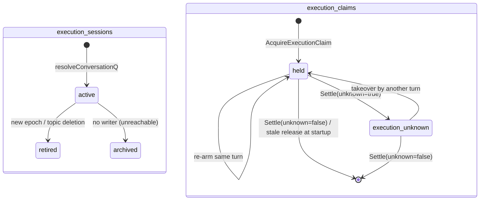

Problems: durable `execution_unknown` does not block re-execution after restart (takeover allowed, `:335-340`; only in-memory `ExecutionUncertain` gates, empty after restart; documented as P1/D056). Binding handler marks the claim unknown per folder, not per thread (`cmd/gopod/session_binding.go:89`). Legacy `sessions` row machine: `ClearSession` with continuity store never deletes the legacy row (`runner.go:1177-1183`); `sessionGone` treats non-0/1 exit as "exists" and loops each turn (`internal/runner/session.go:132-137`).

---

## 11. Elevated (ROOT) host session

Entity: `Elevated{session.ID, blocked, busy, draining, cancel, done, container, heldRelease}` (`internal/runner/elevated.go:22-40`) + `elevated_sessions.closed_at`.

Flag-derived states: Off, Recovering, Starting, Ready, Busy, Blocked-live, Blocked-no-session, Draining, HeldCapacity. Odd but allowed: `blocked && busy`, `session.ID=="" && heldRelease!=nil`.

Transitions: Recover (`elevated.go:96-151`), Start (`:182-197`), beginExecution (`internal/runner/elevated_execution.go:21-30`), container lost -> blocked (`:55-69`), finish release or park (`:33-48`), transport failure -> blocked (`elevated.go:301-323`), Close (`:212-274`), drain -> Close (`:398-414`).

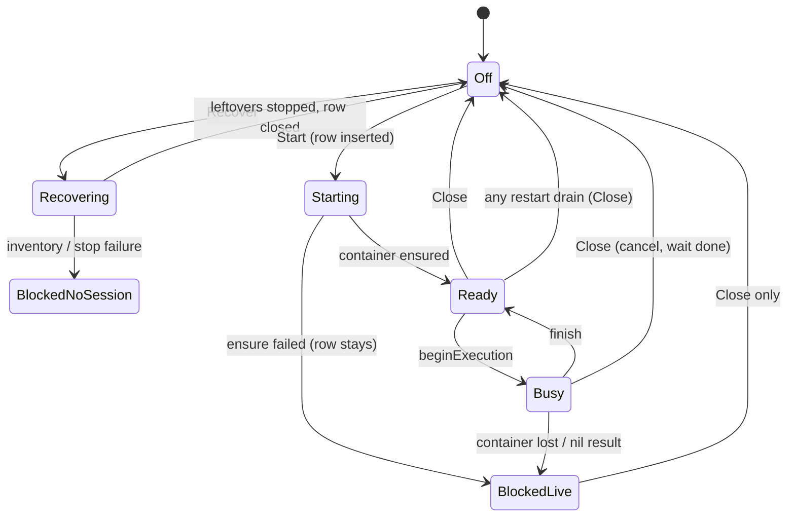

Problems: `Recover` resets session/blocked but never releases `heldRelease` (latent); Starting-failed needs manual `/root stop`; any restart drain (not only force) closes the ROOT session and `CancelDrain` cannot undo it; `Status()` dereferences `engine` without nil check (safe by invariant). Tests decent (`elevated_manager_test.go`, `elevated_login_test.go`).

---

## 12. Group namespace epoch and runtime flags

Entity: `registered_chats(namespace_epoch, group_epoch_ready)` + `router_state` keys `group_disabled`, `group_owner_disabled`, `group_cleanup_unknown`; `autoPrep` in-memory `kicked/inflight/failedAt/stages`; MCP lease `leases -> draining`.

Transitions: `RotateGroupEpoch` (`internal/store/namespace_epochs.go:75-100`), `CompleteGroupEpoch` (`:124-142`), `SetNamespaceDisabled` (`:148-171`), `EnableNamespaceUnlessOwnerDisabled` (`:184-211`), owner Disable two writes (`internal/groupruntime/operations.go:222-230`), Enable clears owner marker after enableCore (`:119-128`), cleanup_unknown set on failures (`reconciliation.go:41-47`, `manager.go:131-133, 295, 404`), cleared in enableCore (`operations.go:193`).

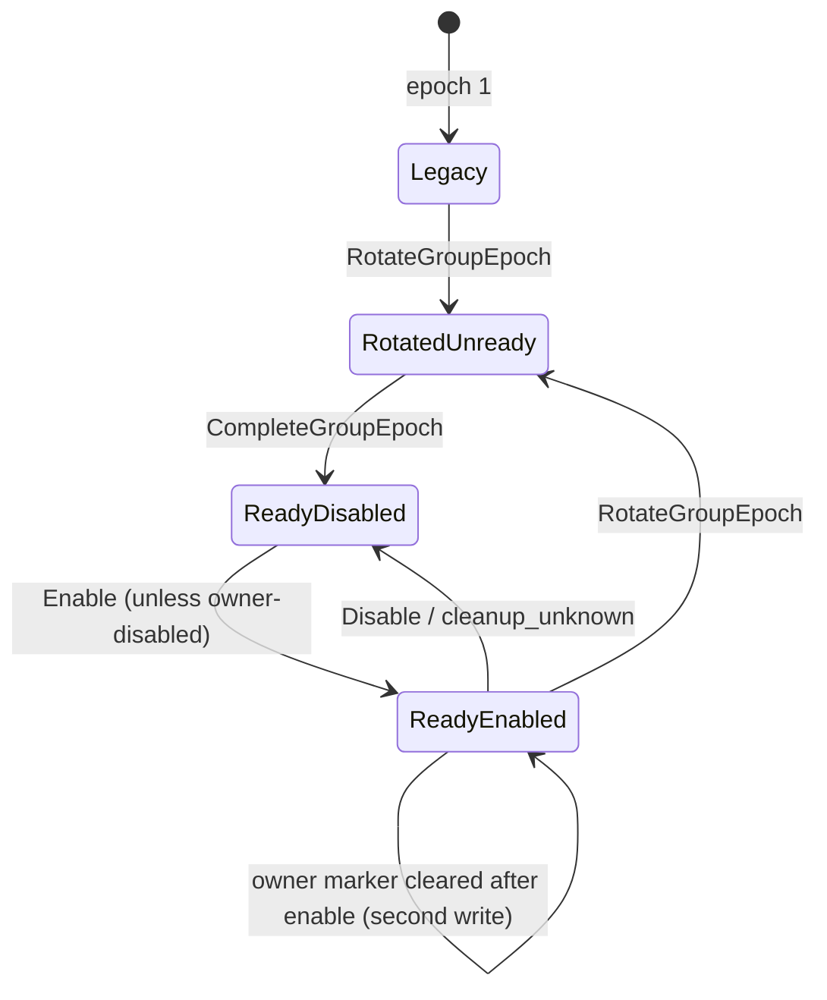

Problems: `Authorize` checks `group_cleanup_unknown` and `group_disabled` but **not** `group_owner_disabled` (`manager.go:74-86`, **verified**); owner Disable is two non-atomic writes, so a failure between them leaves owner marker set with admission open. `stages[jid]` stale after manual enable. MCP timed-out drain blocks `Grant` until process restart (`internal/groupsandbox/mcp.go:48-52`).

---

## 13. Login flow (per private chat)

Entity: `loginSessions{starting map, sessions map}` + `loginSession{awaitsCode, submitted, elevated, ctx, exec}` (`internal/telegram/login.go:37-75`).

Derived states: IDLE, STARTING (handler goroutine blocked in `ReadLine`), AWAIT_CODE, DEVICE_WAIT, SUBMITTED, VERIFYING-UNTRACKED (slot freed, verification still running). `private` is always true, so every `!session.private` guard is dead.

Transitions: reserve (`login.go:189, 89`), release on failure (`:215-219, 240-277, 323-332`), set (`:339-344`), code intercept -> submitted (`:571-614, 440-446`), finish (cleanup at `:492` **before** verify at `:494-500`, **verified**), timeout goroutine (`:411-424`), `cancelUnsafeLogin` (`:559-567`).

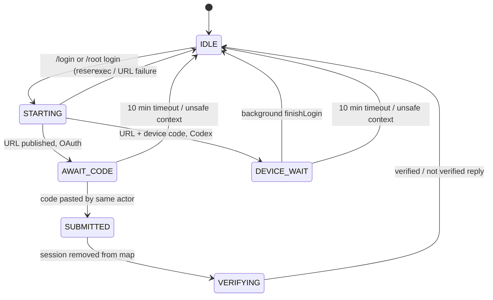

Tests: many privacy and quiescence tests (`login_test.go`, `login_privacy_test.go`, `login_quiescence_test.go`, `elevated_login_test.go`). **Not covered**: timeout notice, URL extraction failure, duplicate code submission, `cancelUnsafeLogin`, `removeIf` identity race.

Problems:
1. Handler goroutine blocks on CLI `ReadLine` up to 10 min (`loginCtx` from `context.Background()`, `:267`); `bot.Run` waits on `inboundHandlers` (`internal/telegram/bot.go:367`) so shutdown can stall behind a login.
2. Slot freed before verification: a second `/login` can start while `checkAuthAfterLogin` still reads the same container.
3. Sessions keyed by chat id only; a code pasted in another topic is consumed and answered in `session.thread`.
4. `finishLogin` checks only `DeadlineExceeded`; a session cancelled by `cancelUnsafeLogin` still verifies and replies.

---

## 14. Streaming placeholder / draft view (per turn)

Entity: locals in `streamReply` (`draftID`, `placeholder`, `overflow`, `silent`) + `Bot.waitPlaceholders` + `turns.placeholder_msg_id` + per-chat `draftsOff`, `draftBadReqs`, `goneThreads`.

View states: DRAFT, EDIT (wait "⏳", cursor "❘", partial, final), NONE/drain; terminals FINAL-new, FINAL-edited, STOPPED, ERROR, CANCELLED.

Transitions: wait notice (`internal/telegram/agentwait.go:75-135`), take wait placeholder (`:157-163`, `streaming.go:346-349`), opening draft or placeholder (`streaming.go:354-373`), overflow (`:433-455`), draft -> edit fallback (`:557-572`), tick edit (`:577-597`), stop (`:461-480, 889-916`), cancel (`:602-603`), error -> `editMessage(ph,"")` (`:636-647`, which `editMessageKBLocked` renders as a lone "❘", `:116-118`, **verified**), final (`:664-727`). `recordPlaceholder` writes `placeholder_msg_id` (`resume.go:47-65`); `reusePlaceholder` is hard-coded `return 0` (`resume.go:102-104`, **verified**).

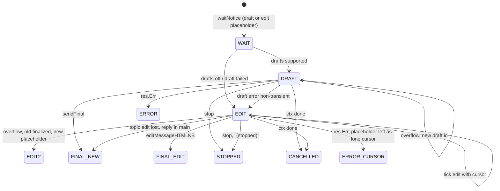

Tests: broad (`streaming_test.go`, `silent_stream_test.go`, thread-gone tests, `agentwait` tests, `private_stop_test.go`, `wait_generation_test.go`, `final_send_test.go`). **Not covered**: ERROR path leaving "❘", `resumingBanner` opening, new-placeholder failure during overflow, final edit failure in thread 0.

Problems: orphan "❘" placeholder after agent error; main-chat final edit failure still records the reply (`:689-700`, `finalEditLost` false for `ThreadID==0`, `:761`), so a turn can be `done` with no visible answer; `placeholder_msg_id` is write-only; `waitPlaceholders` leaks when `streamReply` returns at `:299-301` before `takeWaitPlaceholder`; `draftsOff` sticky until restart on a transient 404; `TOPIC_CLOSED` treated as gone.

---

## 15. Restart record (`router_state["controller:restart"].Phase`)

Phases are free strings: requested, draining, forcing, blocked, restarting, cancelled, aborted, notice_unknown, notice_claimed, ready, degraded (`internal/store/restart.go:12-36`); `SetRestartPhase` does not validate `to` (`:96-114`). Process flags `requested atomic.Bool`, `drainCancel`.

Transitions: `BeginRestart` (`cmd/gopod/restart.go:64-85`), notify failure -> `notice_unknown` (`:92-94, 499-516`), requested -> draining/forcing CAS (`:96-103`), forcing -> aborted (`:109-126`), `RecordForcedTurns` (`internal/store/restart.go:185-253`), completeDrain -> restarting or blocked (`:139-227`), cancel (`:254-276`, drain mode only), `retryForce` blocked -> forcing (`:538-563`), `restoreDrain` at startup -> blocked and re-arm drains (`:520-537`, **verified**), `recovered()` -> notice_claimed -> ready/degraded (`:433-462`), `settleForced` (`:564-599`).

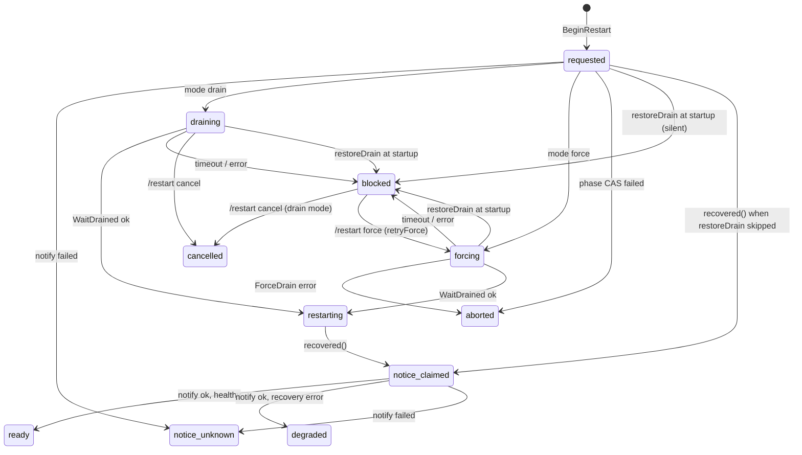

Tests: `cmd/gopod/restart_test.go` covers durability, notice, cancel, force, recovery matrix. **Not covered**: `retryForce`, `restoreDrain`, `UpdateRestartTargets`, `RecordRestartSuppression`, `SettleForcedTurns`, forcing -> aborted.

Problems: `restoreDrain` re-arms queue and runtime drain and moves to `blocked` with no owner notice; drain-mode exit only via manual `/restart cancel` (bot silently stops answering). Force `blocked` exits only via manual `/restart force`. `recovered()` accepts `requested` and reports degraded. `finishPhase` holds `r.mu` up to 5 s on a stalled store. See also §1 (unguarded `stopped` writes) and §2 (stale reservation bug).

---

## 16. IPC message request lifecycle

File states: PENDING (`messages/*.json`, receipt `retrying`) -> `.processed` ACCEPTED (receipt from delivery state) | `.failed` REJECTED (tombstone `ipc_message_requests.outcome=rejected`) | `.failed` CONFLICT. In-memory `retries[path]` backoff (`internal/ipc/ipc.go:100-103`, cap `maxWatcherEntries`).

Transitions: `internal/ipc/durable.go:145-316`, artifacts V1 `internal/ipc/artifacts.go:116-409`, tombstone `internal/store/outbox.go:397-404`.

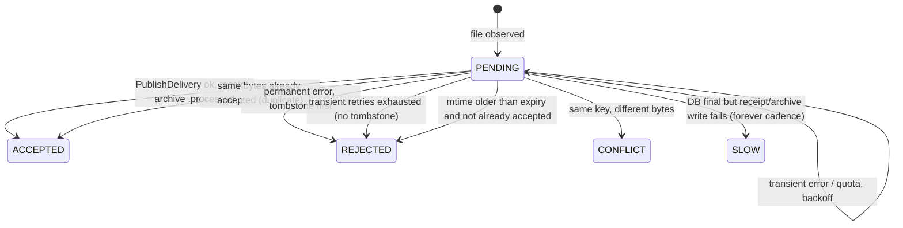

Problems: transient `LookupIPCRequest` error makes `alreadyAccepted` false (`durable.go:292-295`), so an old accepted file is tombstoned `request_expired` while the delivery still sends; `RecordRequestRejection` keeps the accepted row unchanged (`outbox.go:399-404`), so receipt and DB disagree. Under a flood the retry map cap turns transient errors into immediate rejections (`watcher.go:115-116`). Tests extensive (`durable_test.go`, `artifacts_test.go`); tombstone-write-failure fallback not covered.

---

## 17. Artifact inventory (`artifacts.state`, `artifact_reservations.state`)

States: preparing, ready, quarantined, deleting (+ row deleted); reservations active|released (`internal/store/schema_artifacts.go:30,37`).

Transitions: reserve (`internal/store/artifacts.go:124,134`), mark ready CAS preparing (`:266`), publish releases reservation + refs (`:374-381`), abandon -> deleting (`:435-442`), quarantine CAS ready (`:487,519`), restore (`:682`), GC (`:583`), finish deleting (`internal/ipc/artifacts_reconcile.go:99-122`, `artifacts.go:632-654`), verifyReady -> quarantined (`artifacts_reconcile.go:128-180`).

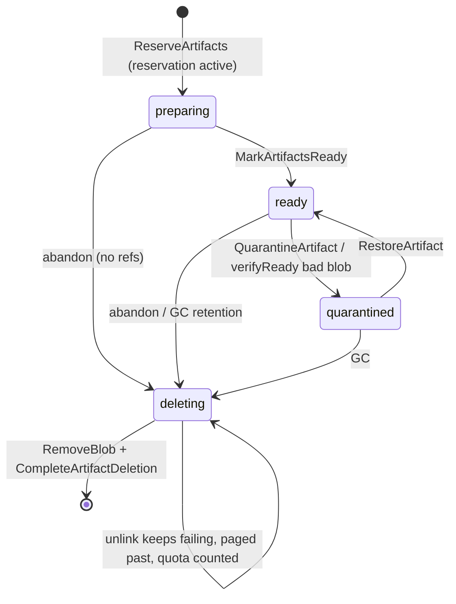

Problems: `deleting` rows with persistently failing unlink leak quota forever (`artifacts_reconcile.go:107-110`, `artifacts.go:156-159`); `quarantined` with an `active` reservation keeps bytes counted until 30-day retention; restore batch aborts when GC moved a row to deleting meanwhile. Tests very good.

---

## 18. Proactive preset state

Derived `off|active|paused` (`internal/proactive/enable.go:14-18`) from `taskState none|done|live|foreign` x `scheduled_tasks.status` x `next_run` (0, -1, >0) x `proactive_presets.applied_hash` x global `keyGlobalOff`. Writers: Enable (`enable.go:98-189`), Disable (`:201-235`), Configure/UpdateSettings/Reset (`:240-354`), PauseAll/ResumeAll (`pause.go:29-152`).

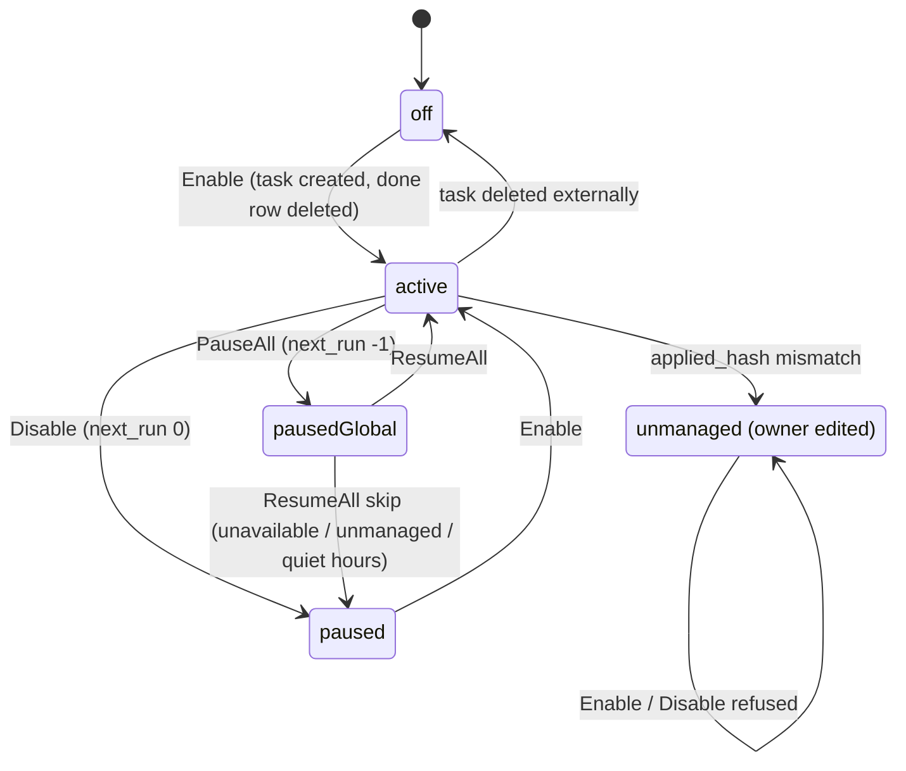

Problems: any live status other than `paused` displays as active; Enable deletes finished task history; during global pause Disable silently drops the preset from the restore set. Tests good.

---

## 19. Smaller machines (brief)

- **Memory status** (`memories.status` active|superseded|archived, no CHECK, `internal/store/schema.go:216`): automatic supersede guarded (`memory_write.go:37-52`); `SupersedeMemory` has no guards (pinned, provenance, self-ref, FK) (`memory_queries.go:77-82`); `DeleteMemory` deletes vector then row without a transaction (`:66-75`); `ArchiveStaleMemories` untested.
- **Group trigger mode** (`group_triggers.mode`): a row whose `namespace_id` no longer matches falls back to `all`, the most permissive mode (`internal/store/group_trigger.go:62-74`, **verified**). Fail-open.
- **Command buttons** (`cmdBtns` tokens LIVE-cc 10 min reusable, LIVE-cf/cx 5 min group-spent, EXPIRED lazy): `cc` tokens never spent, safety by convention (D028); expired tokens linger until next render.
- **Status reactor** (`statusReactor{want,shown,active,done,dead,pending,stall}`): well tested; non-429 write failures drop silently until next Set.
- **Lifecycle notices** (`lifecycle:started_at/graceful_shutdown_at`): both skipped on controller restart, so `started_at` goes stale; shutdown hook order puts outbox stop (10 s) before the 3 s notice window.
- **Album collection** (`albums` map, 1 s window): late item splits one album into two turns.
- **Backup run** (staging -> sealed -> published): after rename success but `dirsync` failure, `Create` returns both a result and an error (`internal/backup/create.go:152-159`); stale staging only cleaned inside `Create`.
- **Legacy run log** `task_run_logs.status`: see §3 problem 4.
- **IPC task claim** (`taskClaimRecord` flags): `held` is a permanent dead end by design (`internal/ipc/task_claim.go:21`); otherwise well tested across restart boundaries.
- **Report capability grant** (in-memory, `internal/taskreport/grants.go`): lost on restart by design.

---

## Cross-cutting problems

1. **Unguarded terminal writes**: `MarkTurnFinished`/`MarkTurnRunning`/`SetTurnReply`, `SettleForcedTurns`, `UpdateTaskStatus`, `FinishTaskRun`, `SetRestartPhase`, `AcknowledgeControlEdit`, `SettleExecutionClaim`, `SupersedeMemory`, `requestRunStopQ` run UPDATE by id with no `WHERE state=`.
2. **Dead ends with no automatic or operator exit**: outbox `uncertain` (operator only), ledger `pending` after crash (none), topic `deleting/uncertain` (writers unwired), final reply `preparing`/held `ready`, managed `execution_unknown` (forced restart only; reservation `none` variant has nothing), runner `unknownExecutions[f]=<id>` with a live idle container, restart `blocked` after `restoreDrain`, queue `ordinaryHold`/`forcing`, artifacts `deleting` with failing unlink, MCP timed-out drain.
3. **Unreachable or dead**: `execution_sessions.lifecycle='archived'`, `publication_state`, `task_runs.result_id`, `effects_state='reconciled'` in production, `Resumed`/`ErrCrashLoop` replay for ordinary turns, `reusePlaceholder`, `leftoverStale`/`requirePolicyLabels`, `drainPending`, `CompactTerminalDeliveries`, topic deletion writers, `PrepareFrozenFinalReply`, managed admission/definition API, `!session.private` guards.
4. **Sub-state hidden in free text or sentinels**: `turns.error` contains `execution_unknown`; `next_run=-1`; restart phases as strings.
5. **Layer inconsistencies**: turn row terminal `failed` while attempt is live `execution_unknown`; stored control `terminal` flag vs recomputed terminality; `placeholder_msg_id` written, never read; durable `execution_unknown` claim vs in-memory `ExecutionUncertain` after restart; group `owner_disabled` marker vs `Authorize`.
6. **Races**: shutdown vs `beginBatch` (pending finished as stopped); forced restart snapshot vs handler completion (`done` -> `stopped`); login slot freed before verification; `RequeueControlRepair` vs concurrent `FinishControlRepair`; `RotateGroupEpoch` without task lock.
7. **Global stalls from local faults**: outbox integrity checks inside the shared claim transaction; login `ReadLine` blocking shutdown.

## Transitions not covered by tests (consolidated)

`SettleForcedTurns`, cmd `settleForced` (both branches), queue `queue.go:457/486` pending->stopped, drain-during-backoff (`queue.go:573-594`), `SetTurnReply` overwrite, conversation NoReplay->failed, `ReopenConversationAfter` at queue level, scheduler `scheduler.go:149,161` writes, `IPCSink.Manage`, `FinishTaskRun` overwrite, `task_deleted` outbox cancel, `CompactTerminalDeliveries` from production, `reconcileExited` clearing, `Unknown(unresolved)`, `stopQuarantined`, `inventoryLeftovers` (integration only), `retryForce`, `restoreDrain`, forcing->aborted, login timeout/extraction failure/duplicate code/`cancelUnsafeLogin`, streaming ERROR path, main-chat final edit failure, IPC tombstone-write failure, `ArchiveStaleMemories`, `SupersedeMemory`, elevated `Recover` after failed `Close`.

---

## Risk ranking and refactoring recommendations

| # | Machine | Risk | Why | Recommendation |
|---|---------|------|-----|----------------|
| 1 | Durable turn `turns.status` | **High** | 12 writers, unguarded terminal writes, `failed/done -> stopped` overwrites, text sub-state, dead replay path, lost-message race | Explicit `TurnState` enum plus one `TransitionTurn(ctx, id, from []TurnState, to, reason)` with `WHERE status IN (...)` and `RowsAffected==1`; promote `execution_unknown` to a column; delete `Resumed`/crash-loop code or restore the replay path deliberately |
| 2 | Managed task ledger | **High** (gated by `GOPOD_MANAGED_TASKS`) | Verified bug in `settleForced`; `execution_unknown` dead ends; five columns with no aggregate; no operator exits | Fix `settleForced` (re-read attempt after settle or drop the `ReleaseHold` branch); add `/tasks reconcile <run>` calling `ReleaseAttemptReservation`/`ReconcileRunEffects`; collapse publication/effects into the typed graph or delete the never-written columns |
| 3 | Restart record phases | **High** | Free-string phases, no validation, silent `blocked` dead end after startup, untested recovery paths | Typed phase enum with transition table in `internal/store/restart.go`; `restoreDrain` must notify the owner or auto-cancel drain-mode requests; tests for `restoreDrain`/`retryForce` |
| 4 | Runner unknown-execution ledgers | **High** | Three or four independent "unknown" stores, folder blocked forever when exec exits but container lives, untested clearing | One per-folder `ExecutionEvidence` state (Known / UnknownExec(id) / UnknownContainer / Quarantined) with explicit clearing rules including "proven quiescent"; persist it alongside `execution_claims` and consult it after restart |
| 5 | Legacy task `status` + `next_run` sentinel | Medium-High | Free text, 15+ writers via one unguarded setter, sentinel sub-states, no CAS, epoch rotation bypass | `CHECK(status IN ...)`, `pause_reason` column instead of `-1`, `UpdateTaskStatus(expectedStatus)` CAS, make `RotateGroupEpoch` take the task lock |
| 6 | Login flow | Medium-High | Flag combination, blocking handler goroutine, slot freed before verification | Explicit `loginState` enum under one mutex, deadline-bounded contexts derived from handler ctx, free slot after verification, key sessions by (chat, thread) |
| 7 | Streaming placeholder view | Medium | Locals plus three per-chat maps plus write-only DB column; orphan cursor; silent lost finals | Small `viewState` struct (Draft / Edit / None) with a reducer applied by tick/overflow/stop/final; either read `placeholder_msg_id` back or drop the column; treat main-chat final edit failure as undelivered |
| 8 | Control message + attempt ledgers | Medium | Stored `terminal` not authoritative, `AcknowledgeControlEdit` without CAS, permanent pending rows | CAS on token+revision in every acknowledge path; add an operator settle command for pending repair/edit/delete rows mirroring `/outbox settle` |
| 9 | Outbox part / delivery group | Medium | Near-explicit already; `uncertain` dead end counts against quota; global stall on integrity error; quarantine tail rule | Keep the design; add per-conversation quarantine state instead of `ErrInvalidDelivery` aborting the claim; make `QuarantineArtifact` cancel the tail; wire `CompactTerminalDeliveries` or delete it |
| 10 | Group namespace flags | Medium | Two-write owner disable, `Authorize` ignores owner marker | Single `group_state` row with one transition function; `Authorize` reads it |
| 11 | Final reply intent, topic deletion | Low-Medium (unwired) | Dead ends by construction, writers unreachable | Decide: wire the host entry and add `preparing/ready -> expired`, or remove the tables; same for topic deletion |
| 12 | Elevated ROOT session | Low-Medium | Eight flags, two mutexes; good tests | Explicit enum (Off/Recovering/Starting/Ready/Busy/Blocked) plus orthogonal `draining`; release `heldRelease` in `Recover` |
| 13 | Durable sessions/claims | Low-Medium | `archived` unreachable; unknown claim does not block after restart (documented) | Remove `archived` or write it; make takeover of `execution_unknown` require evidence |
| 14 | Generation x upload | Low | Overloaded `ready/none`; paid clip lost on write failure | Add `uploaded_via_outbox` or a fifth upload state; retry `CompleteGeneration` before sweep |
| 15 | Artifacts, IPC request, proactive, memory, trigger, buttons, status, backup | Low | Mostly well tested; individual gaps listed above | Point fixes: artifact `deleting` escalation, IPC `alreadyAccepted` fail-closed on lookup error, `CHECK` on `memories.status`, trigger fallback to `mention` not `all`, transaction in `DeleteMemory` |

Suggested order: 1 and 3 first (production paths, owner-visible failures), then 4 and 6, then 5. Item 2 before enabling `GOPOD_MANAGED_TASKS` anywhere.
