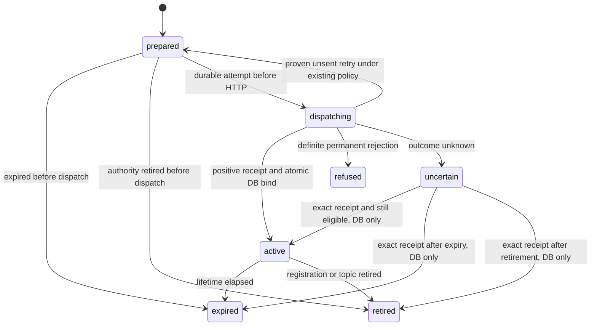

# Telegram status widgets — protocol and lifecycle specification

Date: 2026-11-11. Status: **design draft only; no implementation or activation**.
[CP-041](../../proposals/CP-041-telegram-widgets.md) ·
[Product contract and acceptance](2026-11-11-telegram-widget-panel.md).
Baseline: `da529a8`. This document proposes new contracts; existing D063–D071
reliability guarantees remain binding. Schema names below are logical, not a
migration ready to execute.

## 1. Integration boundary

Keep go-telegram/bot as the only Telegram framework. The installed v1.27.0 lacks
widget support and rawRequest is private. A custom outbound HTTP call alone would
not solve incoming update decoding. Before implementation select and pin an
upstream release with the needed methods/models; if unavailable, bring an explicit
minimal patch/fork proposal for review. No second getUpdates consumer, silent
vendoring, hand-edited module cache or replacement poller.

Required SDK coverage: sendWidget, Widget on Message, WidgetQuery and its typed
query discriminator on Update, answerWidgetQuery. The adapter must decode the
actual API schema, not copy a shortened guide example omitting type. Decode
unknown update/query types without crashing or granting capabilities.

Register widget_query in allowed_updates and dispatch it separately from
CallbackQuery. V1 does not create shared widgets or subscribe to their queries.
If an unexpected shared/inline/wallet update is delivered, no state action occurs.
An identifiable unsupported widget query may receive a generic refusal.

Control owns command permission and snapshot authorization. Telegram owns wire
conversion and template rendering. Store owns SQL, durable identity and delivery
receipts. No package-layout change is needed.

## 2. Creation request and template

Send a fixed, embedded, versioned template with allow_queries=true,
is_shared=false, protect_content=true and the exact source message_thread_id.
public_data is omitted. chat_data contains the compact creation snapshot below.
Use a plain caption; preserve the original route and do not fall back from a topic
to the main chat. A template version change requires a newly requested message;
HTML of an existing widget cannot be edited.

Limits are checked on the actual UTF-8 wire bytes before publication: HTML <=32768
bytes and <=4096 zlib-compressed bytes at maximum compression; chat_data and answer
data <=1024 bytes; request data <=64 bytes; caption <=1024 characters. Leave a
compression margin (target <=3800 bytes) and qualify against the official counting
recipe. JSON string escaping counts toward the serialized data-string size.

Dynamic values are JSON data only. No URLs, secrets or identity capabilities in the
template, state or query data. Model/provider labels are sanitized and bounded to
96/32 UTF-8 bytes respectively; truncate at valid boundaries. If encoding exceeds
the limit, omit optional labels then emit a minimal unavailable snapshot. Do not
truncate serialized JSON. Template never executes values as code.

## 3. Query and response schema

The only accepted data string in V1 is `p1:refresh`. No chat/user/topic IDs,
commands, arbitrary JSON actions or resource identifiers supplied by the client.
The typed query must be the ordinary data variant. Wallet/signing/transaction
queries are rejected. Network access, wallet APIs and external links are unused.

Successful answer data is a compact JSON string, for example:

```json
{"v":1,"ok":true,"observed_at":1794435600,"expires_at":1794522000,"scope":"workspace","state":"running","waiting":2,"provider":"claude","model":"default","started_at":1794435500,"partial":false}
```

Times are UTC Unix seconds; numeric counts are nonnegative or null. state is
idle|queued|running|stopping|unknown. scope is conversation|workspace. Provider,
model and started_at may be null. Initial chat_data uses this same snapshot schema.
The renderer tolerates unknown fields, rejects unsupported v, and treats missing
required fields as unavailable. It never turns invalid input into an idle state.

Error answer:

```json
{"v":1,"ok":false,"error":"unavailable"}
```

Allowed errors: denied, disabled, expired, unavailable, busy, unsupported_version.
Use denied for missing ownership or registration without revealing whether another
conversation exists. Server errors do not contain raw API errors, paths or secrets.
Answer data changes the requesting UI only. V1 does not call editMessageWidgetData
or editSharedWidgetData; consequently it creates no widget-state edit ledger and
makes no cross-device live synchronization promise.

## 4. Authorization and routing

For each command/query, apply current Router permissions. For a query additionally:

1. Require a private chat object, positive message_id and ordinary data type;
   refuse inline/shared forms. The authenticated from.id must match the configured
   owner; the chat must resolve to the registered owner-private conversation.
2. Look up the ACKed widget record by (bot identity, chat_id, message_id). Resolve
   source conversation/thread from that server record, never from query data.
   WidgetQuery does not supply an authoritative source message_thread_id.
3. Require supported template version, unexpired record and matching current
   registration/restore generation. Enforce topic admission/retirement and the
   existing ingress guards. Unknown provenance is a refusal, never main-thread
   inference. Registration reuse must not revive an old card.
4. Dispatch a read-only snapshot request under that verified context. An owner
   clicking from a group must not reach an owner-private snapshot.

A query referencing an unbound or pending send is refused, even if it appears
plausible. Do not use a query as proof to settle an ambiguous send. V1 needs no
client token because Telegram authenticates from and the server owns the binding.

## 5. Deadlines, duplicate queries and load

Answer each admitted query within Telegram's 15-second window. Bound collection to
2 seconds and the overall handler to 10 seconds, leaving transport margin. Errors
and authorization refusals are also answered when a query id is available. Never
wait on an LLM, container start, background refresh or outbox drain.

Use bounded in-memory query-id deduplication (maximum 1024 entries, 60-second TTL)
and single-flight snapshot reads per conversation. An in-flight duplicate joins
its result; an already answered duplicate is ignored. Restart may answer a replay
again, but no business mutation or message creation can result. Do not claim
exactly-once query acknowledgement across crashes. A failed/unknown answer send
is not retried blindly; the user can Refresh again.

Telegram limits queries per user across widgets. Local snapshot cache TTL is five
seconds and preserves its original observed_at; cache hits never relabel old data
as new. Cache only the snapshot payload, keyed by bot identity, resolved execution
scope and registration/restore generation. Invalidate on generation change. Inject
the authorized panel's expires_at into each response after ownership lookup; never
cache a full panel response across messages. Reject excess concurrent work with
busy rather than spawning unlimited readers. No persistent per-query rows or periodic polling in V1.

## 6. Durable creation and ownership

Widget creation is a new externally visible send. Reuse the durable outbox
publication/attempt machinery with a distinct widget part and immutable payload,
not direct SendWidget inside the slash handler. Do not activate the unfinished
foreground final-reply producer to obtain this path. If a bounded control-origin
publisher cannot be integrated independently, implementation is blocked on that
integration rather than bypassing reliability.

The logical panel record contains: internal panel id, inbound invocation identity,
bot identity, source conversation and registration/restore generation, source
thread, template version/hash, immutable payload reference/hash, creation and
expiry timestamps, delivery part id, optional ACKed message id and lifecycle state.
Unique invocation identity includes the bot and inbound update id. Unique ACKed
message identity is (bot, chat, message). Store only required metadata/snapshot;
never add prompts or output bodies. Use existing identity conventions where they
provide these semantics; final migration shape is an implementation review item.

Logical lifecycle:



The lifetime starts when the command is durably admitted: expires_at equals that
time plus 24 hours. Delivery expiry must not exceed panel expiry. Recheck expiry
and retirement before dispatch; prepared work can expire/retire without HTTP.
A positive receipt always settles delivery evidence and binds ownership, even when
late, but activates query access only if still unexpired and authorized. A late
receipt after retirement/expiry produces a retired/expired panel, never revives it.
This rule applies to immediate ACK settlement as well as uncertain recovery. An
unknown send remains uncertain despite expiry: access stays denied and its delivery
evidence is retained until an exact outcome exists.

Crash recovery treats a dispatched attempt without an exact outcome as uncertain.
Never automatically resend or send a text replacement after timeout, connection
loss after dispatch, or an ambiguous DB-ACK failure. Retain exact positive receipts
for DB-only settlement; atomically bind ownership with delivery ACK. Until binding
commits the widget cannot serve snapshots. An owner may explicitly request a new
panel later; that is a new invocation, not settlement of the unknown original.

Definite rejection may produce a text fallback only through the existing durable
conditional-fallback contract, with its own tracked attempt and no prior possible
successful widget send. If that cannot be proven, report the failure through normal
safe diagnostics instead of inventing a new fallback mechanism. Unknown outcome
must never be recategorized as unsupported-client evidence.

## 7. Retirement, backup and retention

New creation participates in topic admission, transport fences, pending-effect
accounting and backup idle checks. It preserves source ownership across restart.
Expired panels stop serving state but are not deleted from Telegram. Gate-off also
stops state access without deleting old messages; source authority is still checked
before returning a disabled answer.

No new widget cleanup timer. Existing bounded retention may remove settled panel
metadata after expiry and a seven-day grace period, provided no receipt, outbox,
provenance, topic fence or backup reference still needs it. Uncertain and unsettled
attempts are never age-cleared. Unknown messages after cleanup receive denied.
Pending-effects reporting must expose unknown widget sends, not just active cards.

Before rollout prove integration with existing backup and topic-idle mechanisms.
Restore/re-registration must invalidate the old binding using durable generation
identity. If that identity cannot be established with the current legacy mapping,
queries stay denied until explicit new creation; do not silently weaken the check.
Schema rollback must preserve new evidence; feature disable is not data deletion.

## 8. Verification and rollout gates

- Wire fixtures: data query with type, absent chat, inline/shared/wallet forms,
  unknown variant, maximum UTF-8 lengths, malformed/oversized state and old version.
- Routing: owner/main/topic, owner in group, non-owner, wrong-message, wrong-bot,
  re-registration, retirement, missing receipt and restored-generation mismatch.
- Faults: pre-dispatch cancellation, definite rejection, 429/proven-unsent retry,
  successful send with failed DB ACK, timeout after possible acceptance, crash at
  every transition, expiry/retirement before dispatch, late positive receipts after
  expiry/retirement, exact-receipt settlement without another HTTP send.
- Concurrency: duplicate command update, repeated refresh, cache expiry, dedup
  capacity, concurrent topic retirement, gate change and two clients.
- Regression: existing command callbacks, login, Stop, text/voice/document outbox,
  update subscription, queue scope and backup idleness remain correct.
- Native acceptance: product W01–W12; record OS, Telegram versions, main/topic route,
  client rendering and actual state freshness separately from HTTP success.

Metrics/logs: created, acknowledged, refused, uncertain, query result class,
latency, snapshot age and cache hits. Use bounded labels; no raw query payloads,
state JSON or identity-bearing high-cardinality metric labels. Apply existing log
redaction. Exact message/attempt identifiers belong only in existing protected
operational evidence where needed for reconciliation.

Implementation acceptance requires independent review, required CI (including
Docker isolation) and focused race tests. Rollout starts gate-off with backup and
rollback evidence; gate-on requires recorded client qualification. This document
neither authorizes that rollout nor starts implementation.

## 9. Sources and unresolved implementation prerequisites

Official API checked 2026-11-11:
- [sendWidget](https://core.telegram.org/bots/api#sendwidget)
- [WidgetQuery](https://core.telegram.org/bots/api#widgetquery)
- [answerWidgetQuery](https://core.telegram.org/bots/api#answerwidgetquery)
- [editMessageWidgetData](https://core.telegram.org/bots/api#editmessagewidgetdata)
- [Widget runtime and testing](https://core.telegram.org/bots/widgets)

Before source work: verify a suitable SDK pin; map authoritative snapshot readers
and legacy scopes; verify control-origin outbox publication and registration/restore
identity reuse. These are explicit implementation prerequisites, not assertions
that the current code already supports widgets. The current API schema takes
precedence over illustrative snippets in the guide. Recheck evolving limits and
production availability at implementation time.
